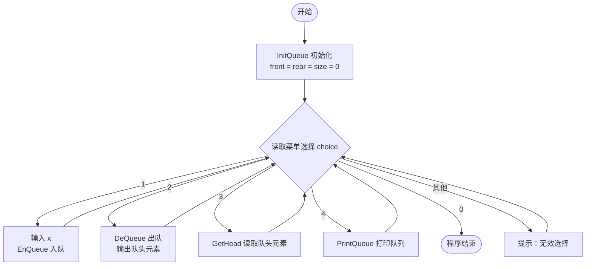
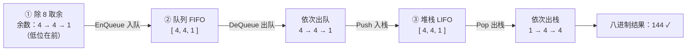
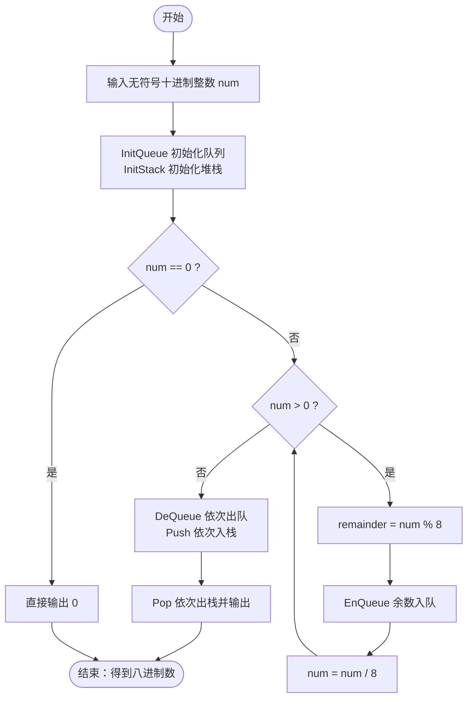

# 数据结构实验报告

| 项目 | 内容 |
| --- | --- |
| 实验名称 | 堆栈与队列的应用 —— 十进制转八进制 |
| 题目1 | 堆栈、队列相关算法的实验验证 |
| 题目2 | 使用队列和堆栈，将无符号十进制正整数转换成八进制数 |
| 班级 | ____________ |
| 姓名 | ____________ |
| 学号 | ____________ |
| 日期 | 2026-11-10 |

---

## 一、实验目的

1. 掌握堆栈、队列的基本概念、存储结构及其基本操作（入队/出队、入栈/出栈等）。
2. 掌握**循环队列**的实现方法，理解其借助取模运算避免"假溢出"的原理。
3. 深刻理解堆栈（**后进先出 LIFO**）与队列（**先进先出 FIFO**）两种特性的区别。
4. 学会综合运用堆栈与队列解决实际问题——将无符号十进制整数转换为八进制数。

---

## 二、题目1：堆栈、队列相关算法的实验验证

### 2.1 设计思路

#### （1）循环队列（Queue）

队列是一种**先进先出（FIFO）**的线性表，只允许在队尾（rear）插入、在队头（front）删除。若采用普通的顺序存储，随着元素的不断出队，队头前的空间会逐渐闲置，导致"队尾满而队头空"的**假溢出**现象。为此，本实验采用**循环队列**：将数组逻辑上首尾相连，`front` 与 `rear` 沿环顺时针移动，通过**取模运算 `% MAXSIZE`** 实现循环。

本实现额外引入一个 `size` 字段记录当前元素个数，使**判空、判满**逻辑简洁且不浪费存储单元：

- 判空：`size == 0`
- 判满：`size == MAXSIZE`

```c
#define MAXSIZE 200

typedef struct {
    int data[MAXSIZE];   // 存储元素
    int front;           // 队头下标
    int rear;            // 队尾下标（指向下一个插入位置）
    int size;            // 当前元素个数
} queue;
```

**循环队列结构示意图（以 MAXSIZE = 8 为例）：**

```
数组下标:   0     1     2     3     4     5     6     7
        ┌─────┬─────┬─────┬─────┬─────┬─────┬─────┬─────┐
  data  │ 10  │ 20  │ 30  │     │     │     │     │     │
        └─────┴─────┴─────┴─────┴─────┴─────┴─────┴─────┘
             ↑front                   ↑rear
                                     (rear 指向下一个待插入位置)

  front = 0     rear = 3     size = 3

  入队：data[rear] = x;   rear = (rear + 1) % MAXSIZE;   size++
  出队：x = data[front];  front = (front + 1) % MAXSIZE;  size--
```

**环形（循环）视角：**

```
                data[0]
             ↙          ↘
       data[7]          data[1]
         ↗                  ↘
    data[6]                data[2]
         ↖                  ↙
       data[5]          data[3]
             ↖          ↗
                data[4]

   front、rear 沿环顺时针移动，靠 (下标 + 1) % MAXSIZE 实现循环。
```

**队列基本操作：**

| 操作 | 函数 | 说明 |
| --- | --- | --- |
| 初始化 | `InitQueue` | `front = rear = size = 0` |
| 入队 | `EnQueue` | 判满 → 插入队尾 → 移动 rear |
| 出队 | `DeQueue` | 判空 → 取队头 → 移动 front |
| 读队头 | `GetHead` | 判空 → 返回 `data[front]`，不删除 |
| 打印 | `PrintQueue` | 从 front 起遍历 size 个元素 |

**菜单式交互流程：**



#### （2）顺序栈（Stack）

堆栈是一种**后进先出（LIFO）**的线性表，只允许在栈顶（top）进行插入和删除。本实验采用**顺序栈**：用一维数组存储，`top` 指向栈顶元素的下标。`top = -1` 表示空栈。

```c
#define MAXSIZE 200

typedef struct {
    int data[MAXSIZE];   // 存储元素
    int top;             // 栈顶下标
} Stack;
```

**顺序栈结构示意图：**

```
  下标:   0     1     2     3    ...   MAXSIZE-1
       ┌─────┬─────┬─────┬─────┬─────┬─────────┐
  data │  a  │  b  │  c  │     │ ... │         │
       └─────┴─────┴─────┴─────┴─────┴─────────┘
                         ↑ top = 2  (栈顶元素为 c)

  入栈 Push：data[++top] = x          判满：top == MAXSIZE - 1
  出栈 Pop ：x = data[top--]          判空：top == -1
```

> 说明：题目1 的 `main.c` 对**循环队列**进行了完整的菜单式交互验证；顺序栈的 `InitStack / Push / Pop` 在 `change.c` 中定义，其正确性通过题目2的进制转换加以验证。

### 2.2 实验代码（main.c）

```c
#include<stdio.h>
#include<stdlib.h>

#define MAXSIZE 200

//定义循环队列结构体
typedef struct{
    int data[MAXSIZE];
    int front;
    int rear;
    int size;
}queue;

//创建队列
void InitQueue(queue *q){
    q->front=0;
    q->rear=0;
    q->size=0;

    printf("队列创建成功！\n");
}

//插入操作：入队
void EnQueue(queue *q,int x){
    if(q->size==MAXSIZE){
        printf("队列已满，无法插入！\n");
        return;
    }

    q->data[q->rear]=x;
    q->rear=(q->rear+1)%MAXSIZE;

    q->size++;
    printf("元素%d插入成功\n",x);
}

//删除操作：出队
void DeQueue(queue *q){
    if(q->size==0){
        printf("队列为空，无法删除\n");
        return;
    }

    int x=q->data[q->front];
    q->front=(q->front+1)%MAXSIZE;

    q->size--;
    printf("删除的队头元素是：%d\n",x);
}

//存取操作：读取队头元素
void GetHead(queue *q){
    if(q->size==0){
        printf("队列为空，没有队头元素\n");
        return;
    }

    printf("当前队头元素是：%d\n",q->data[q->front]);
}

//打印队列
void PrintQueue(queue *q){
    if(q->size==0){
        printf("当前队列为空\n");
        return;
    }

    printf("当前队列：");

    for(int i=0;i<q->size;i++){
        int index=(q->front+i)%MAXSIZE;
        printf("%d",q->data[index]);
    }

    printf("\n");
}

int main(void){
    system("chcp 65001");  // 控制台切换到 UTF-8，避免中文乱码
    queue q;
    int choice;
    int x;

    InitQueue(&q);
    while(1){
        printf("\n======队列操作菜单======\n");
        printf("1. 插入元素（入队）\n");
        printf("2. 删除元素（出队）\n");
        printf("3. 读取队头元素\n");
        printf("4. 打印队列\n");
        printf("0. 退出程序\n");
        printf("请选择操作：");

        if(scanf("%d",&choice)!=1){
            printf("输入错误！\n");
            return 1;
        }

       switch (choice) {
            case 1:
                printf("请输入要插入的元素：");
                if (scanf("%d", &x) != 1) {
                    printf("输入错误！\n");
                    return 1;
                }
                EnQueue(&q, x);
                break;

            case 2:
                DeQueue(&q);
                break;

            case 3:
                GetHead(&q);
                break;

            case 4:
                PrintQueue(&q);
                break;

            case 0:
                printf("程序结束！\n");
                return 0;

            default:
                printf("无效选择，请重新输入！\n");
        }
    }
    return 0;
}
```

### 2.3 运行结果与验证

按顺序执行「入队 10 → 入队 20 → 入队 30 → 打印 → 读队头 → 出队 → 打印 → 退出」，运行结果如下：

```
队列创建成功！

======队列操作菜单======
请选择操作：请输入要插入的元素：元素10插入成功
请输入要插入的元素：元素20插入成功
请输入要插入的元素：元素30插入成功
当前队列：102030
当前队头元素是：10
删除的队头元素是：10
当前队列：2030
程序结束！
```

**验证结论：**

| 操作 | 预期结果 | 实际结果 | 结论 |
| --- | --- | --- | --- |
| 依次入队 10、20、30 | 队头为 10 | 打印 `102030`，队头为 10 | ✓ FIFO 正确 |
| 读取队头 | 返回 10（不删除） | 输出 10 | ✓ 正确 |
| 出队 | 删除队头 10 | 输出 10，剩余 `2030` | ✓ 正确 |

出队后队头由 10 变为 20，符合先进先出的特性，验证了循环队列各操作的正确性。

---

## 三、题目2：无符号十进制整数转八进制

### 3.1 设计思路

#### （1）进制转换原理：除 8 取余法

十进制整数转八进制采用"**除 8 取余、逆序排列**"：反复用 `num` 除以 8，记录每次的余数，直到商为 0，最后把余数**从后往前**依次写出来，即为八进制数。

**以十进制 100 为例：**

```
  100 ÷ 8 = 12 …… 余 4   （最低位，先产生）
   12 ÷ 8 =  1 …… 余 4
    1 ÷ 8 =  0 …… 余 1   （最高位，后产生）

  余数产生顺序（低位 → 高位）： 4 → 4 → 1
  正确八进制结果（高位 → 低位）： 144
```

> 核心难点：余数**先得到的反而是低位**，与最终输出的顺序正好**相反**，因此需要一个"反转顺序"的机制。

#### （2）利用"队列 + 堆栈"反转顺序

本实验巧妙地利用两种数据结构的特性，分三步完成转换：

1. **入队（FIFO）**：将除 8 得到的余数**依次入队**，队列保持余数的产生顺序。
2. **队列转堆栈（FIFO → LIFO）**：将队列元素**依次出队**并**依次入栈**。
3. **出栈（LIFO）**：将堆栈元素**依次出栈**，由于栈是"后进先出"，出栈顺序恰为入栈顺序的反序，从而得到正确的八进制高位在前顺序。



**整体算法流程：**



#### （3）健壮性设计

相比题目1，`change.c` 做了两处改进：

- **接口更规范**：队列、堆栈操作函数返回 `int`（1 成功 / 0 失败），并通过指针参数返回出队/出栈的值，内部不再直接 `printf`，便于复用；主流程单独打印调试信息。
- **输入校验严格**：使用 `strtoull` + `errno` 检测输入是否为合法的无符号十进制整数，排除负数、空输入、非数字字符、数值溢出、超长输入等异常情况。

### 3.2 实验代码（change.c）

```c
#include <stdio.h>
#include <stdlib.h>
#include <string.h>
#include <ctype.h>
#include <errno.h>
#include <limits.h>

#define MAXSIZE 200

// ==================== 循环队列定义 ====================

typedef struct {
    int data[MAXSIZE];
    int front;
    int rear;
    int size;
} Queue;

// 初始化队列
void InitQueue(Queue *q) {
    q->front = 0;
    q->rear = 0;
    q->size = 0;
}

// 入队：将元素插入队尾
int EnQueue(Queue *q, int x) {
    if (q->size == MAXSIZE) {
        printf("队列已满！\n");
        return 0;
    }

    q->data[q->rear] = x;
    q->rear = (q->rear + 1) % MAXSIZE;
    q->size++;

    return 1;
}

// 出队：删除队头元素，并通过x返回其值
int DeQueue(Queue *q, int *x) {
    if (q->size == 0) {
        return 0;
    }

    *x = q->data[q->front];
    q->front = (q->front + 1) % MAXSIZE;
    q->size--;

    return 1;
}

// ==================== 顺序栈定义 ====================

typedef struct {
    int data[MAXSIZE];
    int top;
} Stack;

// 初始化栈
void InitStack(Stack *s) {
    s->top = -1;
}

// 入栈：将元素压入栈顶
int Push(Stack *s, int x) {
    if (s->top == MAXSIZE - 1) {
        printf("堆栈已满！\n");
        return 0;
    }

    s->data[++s->top] = x;
    return 1;
}

// 出栈：取出栈顶元素
int Pop(Stack *s, int *x) {
    if (s->top == -1) {
        return 0;
    }

    *x = s->data[s->top--];
    return 1;
}

// ==================== Change函数 ====================

// 将无符号十进制整数转换为八进制数
void Change(unsigned long long num) {
    Queue q;
    Stack s;

    int remainder;
    int x;

    // 初始化队列和堆栈
    InitQueue(&q);
    InitStack(&s);

    // 特殊情况：输入为0
    if (num == 0) {
        printf("八进制转换结果为：0\n");
        return;
    }

    printf("\n========== 转换过程 ==========\n");

    // 第一步：采用除8取余法，将余数依次放入队列
    while (num > 0) {
        remainder = num % 8;

        // 将余数放入队列
        EnQueue(&q, remainder);

        // 输出调试信息，方便观察转换过程
        printf("当前被除数：%llu，余数：%d，商：%llu\n",
               num, remainder, num / 8);

        // 用商替代原来的数，继续计算
        num = num / 8;
    }

    printf("\n========== 队列转堆栈 ==========\n");

    // 第二步：将队列中的元素依次出队，并压入堆栈
    while (DeQueue(&q, &x)) {
        Push(&s, x);

        // 调试信息
        printf("元素%d出队，并进入堆栈\n", x);
    }

    printf("\n========== 最终转换结果 ==========\n");

    // 第三步：依次出栈，输出正确顺序的八进制数
    printf("十进制数对应的八进制数为：");

    while (Pop(&s, &x)) {
        printf("%d", x);
    }

    printf("\n");
}

// ==================== Check函数 ====================

// 检查输入的十进制整数是否合法，并调用Change函数
int Check(const char *input) {
    char *endptr;
    unsigned long long num;
    const char *start = input;

    // 跳过开头的空白字符
    while (isspace((unsigned char)*start)) {
        start++;
    }

    // 不允许负数和空输入
    if (*start == '\0' || *start == '-') {
        printf("输入错误！请输入无符号十进制整数。\n");
        return 0;
    }

    // 将字符串转换为无符号整数
    errno = 0;
    num = strtoull(start, &endptr, 10);

    // 检查转换失败或数值溢出
    if (errno == ERANGE || endptr == start) {
        printf("输入错误！数字超出范围或格式不正确。\n");
        return 0;
    }

    // 检查数字后是否存在非法字符
    while (isspace((unsigned char)*endptr)) {
        endptr++;
    }

    if (*endptr != '\0') {
        printf("输入错误！请勿输入非数字字符。\n");
        return 0;
    }

    // 调用Change函数完成进制转换
    Change(num);

    return 1;
}

// ==================== 主函数 ====================

int main(void) {
    system("chcp 65001");
    char input[256];

    printf("========== 十进制转换八进制程序 ==========\n");

    printf("请输入一个无符号十进制整数：");

    if (fgets(input, sizeof(input), stdin) == NULL) {
        printf("输入失败！\n");
        return 1;
    }

    // 检查输入是否完整，防止超长输入被截断
    if (strchr(input, '\n') == NULL && !feof(stdin)) {
        printf("输入错误！输入内容过长。\n");
        return 1;
    }

    // 调用Check函数进行输入检查和转换
    Check(input);

    return 0;
}
```

### 3.3 运行结果与验证

**测试 1：输入 100**

```
========== 十进制转换八进制程序 ==========
请输入一个无符号十进制整数：
========== 转换过程 ==========
当前被除数：100，余数：4，商：12
当前被除数：12，余数：4，商：1
当前被除数：1，余数：1，商：0

========== 队列转堆栈 ==========
元素4出队，并进入堆栈
元素4出队，并进入堆栈
元素1出队，并进入堆栈

========== 最终转换结果 ==========
十进制数对应的八进制数为：144
```

**测试 2：输入 0（边界情况）**

```
请输入一个无符号十进制整数：八进制转换结果为：0
```

**测试 3：输入 1024**

```
========== 转换过程 ==========
当前被除数：1024，余数：0，商：128
当前被除数：128，余数：0，商：16
当前被除数：16，余数：0，商：2
当前被除数：2，余数：2，商：0

========== 队列转堆栈 ==========
元素0出队，并进入堆栈
元素0出队，并进入堆栈
元素0出队，并进入堆栈
元素2出队，并进入堆栈

========== 最终转换结果 ==========
十进制数对应的八进制数为：2000
```

**验证结论：**

| 输入 | 除 8 取余序列（低位→高位） | 正确八进制 | 程序输出 | 结论 |
| --- | --- | --- | --- | --- |
| 100 | 4, 4, 1 | 144 | 144 | ✓ |
| 0 | （无） | 0 | 0 | ✓ |
| 1024 | 0, 0, 0, 2 | 2000 | 2000 | ✓ |

余数 `4 → 4 → 1` 经"队列保持顺序、堆栈反转顺序"后，正确输出为 `144`，验证了队列与堆栈协同完成进制转换的正确性。

---

## 四、实验心得

通过本次实验，我对堆栈和队列这两种基本数据结构有了更深入的理解和体会：

1. **深刻理解了 FIFO 与 LIFO 的本质区别。** 队列的先进先出和堆栈的后进先出，看似只是顺序上的差别，却在问题求解中扮演了完全不同的角色。题目2中正是利用了"队列保序 + 堆栈反序"的组合，优雅地解决了进制转换中"余数顺序与输出顺序相反"的问题，让我体会到数据结构特性与实际算法的紧密结合。

2. **掌握了循环队列的设计要点。** 普通顺序队列会因队头元素出队而产生"假溢出"，循环队列通过 `(下标 + 1) % MAXSIZE` 的取模运算让 `front`、`rear` 在数组中循环移动，充分利用了存储空间。额外引入 `size` 字段记录元素个数，使判空、判满条件变得非常简洁，避免了牺牲一个存储单元或用标志位判断的复杂做法。

3. **体会到了良好的接口设计的重要性。** 题目1 中队列操作函数直接打印结果，与"逻辑"耦合较紧；题目2 中将操作函数改为返回成功/失败标志（`int`），并通过指针参数返回数据，实现了逻辑与输出的分离，函数更规范、更易于复用。这一改进让代码结构更加清晰。

4. **认识到健壮性设计不可忽视。** 题目2 使用 `strtoull` 配合 `errno` 对输入做了严格校验，能正确处理负数、空输入、非数字字符、溢出和超长输入等异常情况，保证了程序在边界条件下的正确运行，这是编写可靠程序的重要习惯。

5. **学会用可视化方式分析算法。** 通过绘制循环队列环形图、顺序栈示意图和进制转换流程图，抽象的算法过程变得直观清晰，有助于在设计阶段理清思路、排查逻辑错误。
